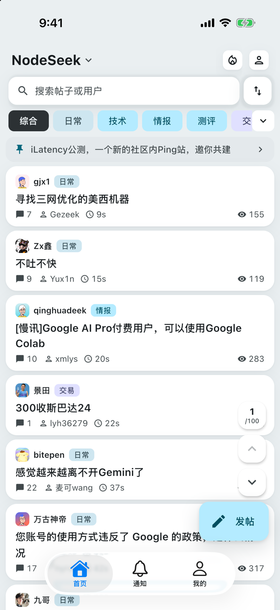
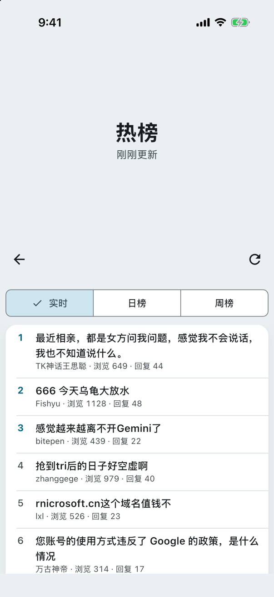
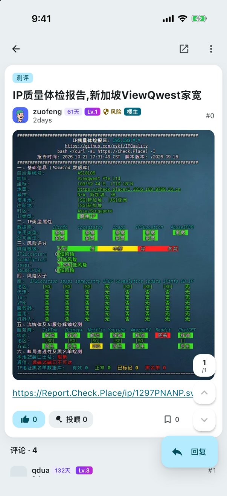
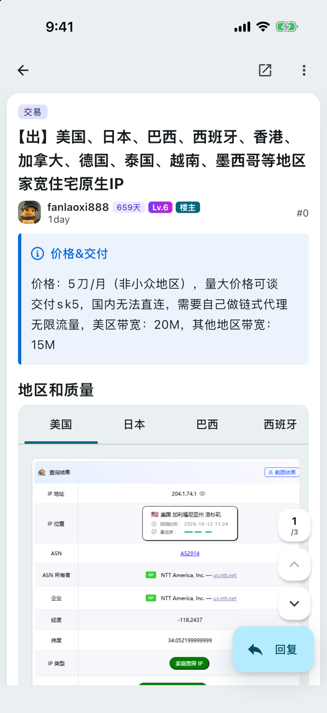
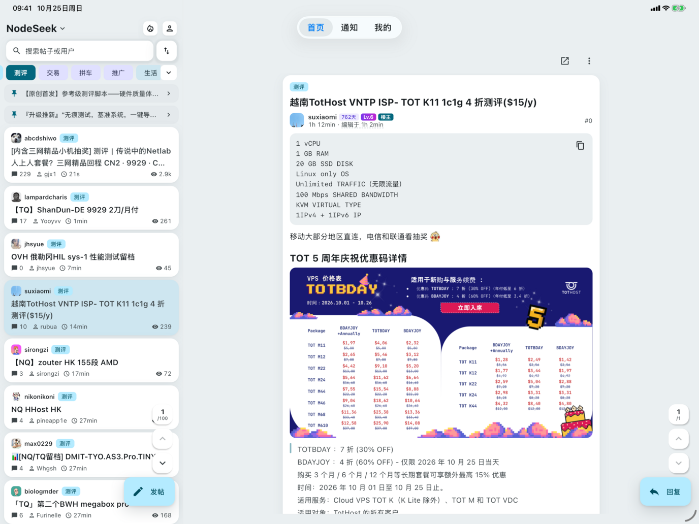
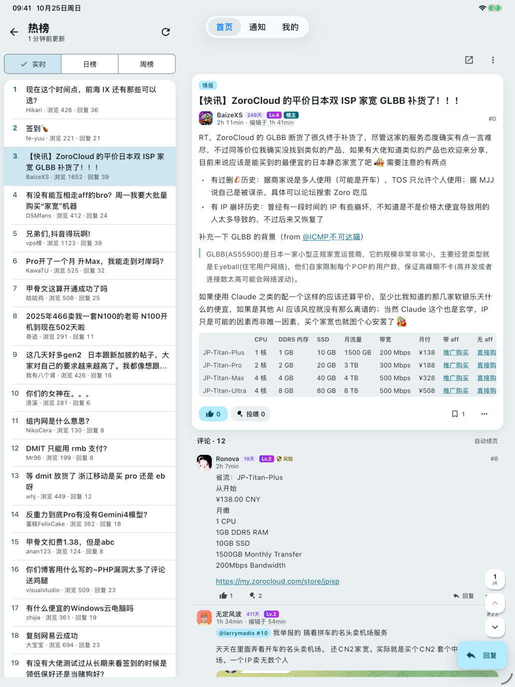

# Nodyssey iOS 改版

[Nodyssey](https://github.com/5151561/nodyssey) 是 [NodeSeek](https://www.nodeseek.com/) 的非官方客户端（Kotlin Multiplatform + Compose）；本仓库是它的 iOS 分支：修复原版在 iPhone 上的几处闪退和交互问题，补上 iPad 布局，另加几个小功能

基于原版 v1.2.22 · 个人维护，不保证跟进原版更新

<table>
  <tr>
    <td align="center"></td>
    <td align="center"></td>
    <td align="center"></td>
    <td align="center"></td>
  </tr>
  <tr>
    <td align="center"><b>新增</b> 头像旁的火苗按钮</td>
    <td align="center"><b>新增</b> 热榜：实时 / 日榜 / 周榜</td>
    <td align="center"><b>修复</b> IP 报告 SVG 不再是黑块 <b>新增</b> 注册天数 · 等级 · 风险</td>
    <td align="center"><b>新增</b> 和网页一样的彩色提示框</td>
  </tr>
</table>

<table>
  <tr>
    <td align="center"></td>
    <td align="center"></td>
  </tr>
  <tr>
    <td align="center"><b>iPad</b> 横屏双栏：列表 + 帖子，当前帖子在列表中高亮</td>
    <td align="center"><b>iPad</b> 热榜同样以双栏打开</td>
  </tr>
</table>

截图来自 iOS 模拟器，iPad 为 13 英寸 iPad Pro 横屏

> 这个改版**不是原作者发布的**，有问题请在本仓库提 issue，别去找原作者；只做 iOS，安卓请直接用[原版](https://github.com/5151561/nodyssey)

## 下载与安装

到 [Releases](https://github.com/eddielee214/nodyssey-wa/releases) 下载 `.ipa`

ipa **没有签名**，需要用你自己的 Apple ID 或证书签名后安装，例如：

- [Sideloadly](https://sideloadly.io/)：电脑连上 iPhone，拖入 ipa，填 Apple ID 即可安装（免费 Apple ID 签的 App 7 天后要重签）
- [AltStore](https://altstore.io/)
- 有开发者证书的话，可以用自己的证书和描述文件重签

## 相对原版的改动

**修复**

- 听写输入时闪退（Compose 文本分词器越界，已在 App 层拦截）
- 发帖、编辑简介时界面卡死并闪退（键盘避让与页面自身的键盘留白叠加，主线程在布局中循环，被系统看门狗终止）
- 从通知打开帖子时看不到刚发的新回复
- 上传的图片插入到光标处，而不是追加到正文末尾
- 编辑资料保存后收起键盘；简介输入框的回车键改为「完成」
- IP 质量报告等 SVG 图片显示为黑块
- 私信对话页不会自动收到新消息（现在打开时每 10 秒拉取一次，回到前台立即刷新）
- 快速滑到顶部后无法立即下拉刷新（iOS 回弹占用了下拉手势；带下拉刷新的列表已关闭回弹）
- 已登录时「我的」等页面提示「登录状态没被认出来」（首页出现标题带「权限不足」的帖子时，整页被误判为登录页；现在只按站点自己的界面文字判断，帖子标题、正文和签名里的字眼不算数）

**新增**

- iPad 适配，与 iPhone 共用同一个 ipa，iPhone 上的界面不变：
  - 窗口宽度不小于 840pt 时（横屏，或 13 英寸竖屏）切换为双栏：左栏 360pt 列表，右栏详情；首页、热榜、搜索、通知、个人空间，以及「我的」里的主题帖、评论、收藏、浏览历史均适用
  - 从列表打开帖子会替换右栏内容；帖子内的链接在右栏逐层打开，可以返回
  - 分屏、台前调度或旋转时在单栏与双栏之间切换，保留阅读位置
  - 「我的」宽屏分为两栏，顶栏按钮与内容列对齐；全屏页面隐藏顶部标签栏；iPad 上不提供单手模式
  - 回复框为屏幕中间的卡片，随键盘上移
- 帖子和每层回复显示作者的注册天数、等级和风险提示
- 首页热榜（实时 / 日榜 / 周榜，数据来自第三方 bimg.eu.org），按钮放在头像旁边
- 切换 NodeSeek / DeepFlood 立即生效，不用重启 App
- 帖子里的提示框（`> [!note] 标题`）显示成和网页一样的彩色框

## 原版功能

- **浏览与互动**：发帖、评论、编辑；点赞 / 反对 / 投喂鸡腿、收藏、签到；投票帖阅读与投票
- **消息与社交**：通知与未读数、私信、关注 / 粉丝、用户空间
- **账号**：鸡腿与星辰流水、星辰转账与收款码、等级进度、账号设置
- **阅读体验**：离线缓存、已读标记、浏览历史与阅读位置、图片预览 / 保存 / 分享、六种图床上传
- **界面**：Material 3 Expressive；简体 / 繁體 / English 三语

## 致谢

- [5151561/nodyssey](https://github.com/5151561/nodyssey)：原项目，本改版就是在它上面改的
- [tyrad/nodeseek](https://github.com/tyrad/nodeseek)、[mrzhiin/seekmate](https://github.com/mrzhiin/seekmate)：原项目在致谢里列出的参考实现

## 说明

本项目与 NodeSeek 官方无关，是社区自制客户端；仓库中不保存任何 Cookie 或凭据

## 许可

与原项目相同，[GPL-3.0](LICENSE)；本仓库就是对应 ipa 的完整源码
